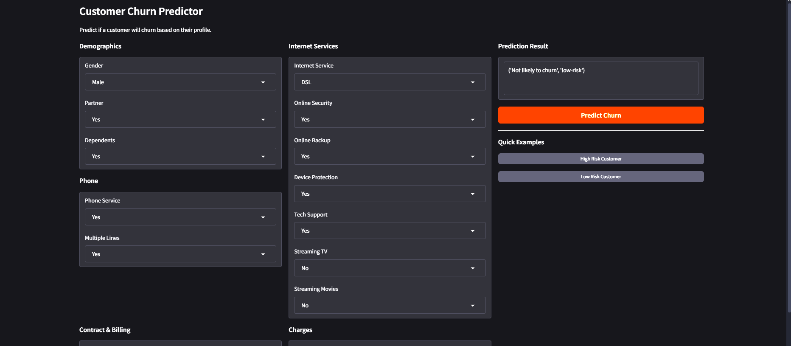

# CustomerRetentionPrediction

> Predict. Protect. Retain.  An end-to-end MLOps system that identifies at-risk customers before they walk away.
## Demo UI

## Overview

Customer churn costs businesses **5-25x more** than retaining existing customers. This project tackles that challenge head-on with a production-ready machine learning pipeline that predicts customer churn with **94.1% recall**  catching nearly every at-risk customer before it's too late.

Built with MLOps best practices, this system transforms raw customer data into actionable retention insights through automated pipelines, experiment tracking, and seamless cloud deployment.

## Key Features

- **High-Recall Model**: Optimized to minimize missed churners (94.1% recall) because the cost of losing a customer far exceeds a false alarm
- **End-to-End Pipeline**: From raw data to production API in a single, reproducible workflow
- **Experiment Tracking**: Full MLflow integration for model versioning and metric comparison
- **Real-Time Inference**: 5ms prediction latency via FastAPI + interactive Gradio UI
- **Cloud-Native Deployment**: Dockerized and deployed on AWS ECS Fargate with CI/CD automation

## Tech Stack

| Category | Tools |
|----------|-------|
| **ML Framework** | XGBoost, LightGBM, Random Forest, Scikit-learn |
| **Hyperparameter Tuning** | Optuna (30 trials, recall-optimized) |
| **Experiment Tracking** | MLflow |
| **API & UI** | FastAPI, Gradio |
| **Containerization** | Docker |
| **CI/CD** | GitHub Actions |
| **Cloud Deployment** | AWS ECS Fargate |
| **Data Validation** | Great Expectations, Custom Validators |

## Model Comparison

Experimented with three gradient boosting and ensemble methods, optimizing for **recall** to minimize costly missed churners:

| Model | Precision | Recall | F1-Score | ROC-AUC |
|-------|-----------|--------|----------|---------|
| Random Forest | 51.9% | 71.9% | 0.603 | 0.821 |
| LightGBM | 47.7% | 84.0% | 0.609 | 0.836 |
| XGBoost | 46.5% | 84.2% | 0.599 | 0.832 |
| **XGBoost + Optuna** | **42.2%** | **94.1%** | **0.582** | **0.849** |

**Why XGBoost + Optuna?**
- Achieved **+9.9% recall improvement** through hyperparameter optimization
- Prioritized recall over precision  missing a churner costs more than a false retention offer
- Threshold tuned to 0.25 for optimal business impact

## Key Insights from EDA

- **Tenure** is the strongest predictor of retention (correlation: -0.35)
- **Fiber optic customers** have the highest churn rate despite being premium users
- **Month-to-month contracts** are 5x more likely to churn than two-year contracts
- **Electronic check** payment method correlates with higher churn risk

## Deployment

The system is deployed on **AWS ECS Fargate** with:
- Automated Docker builds via GitHub Actions
- Image registry on Docker Hub (`richard519/churn-prediction-api:latest`)
- Serverless compute with automatic scaling

